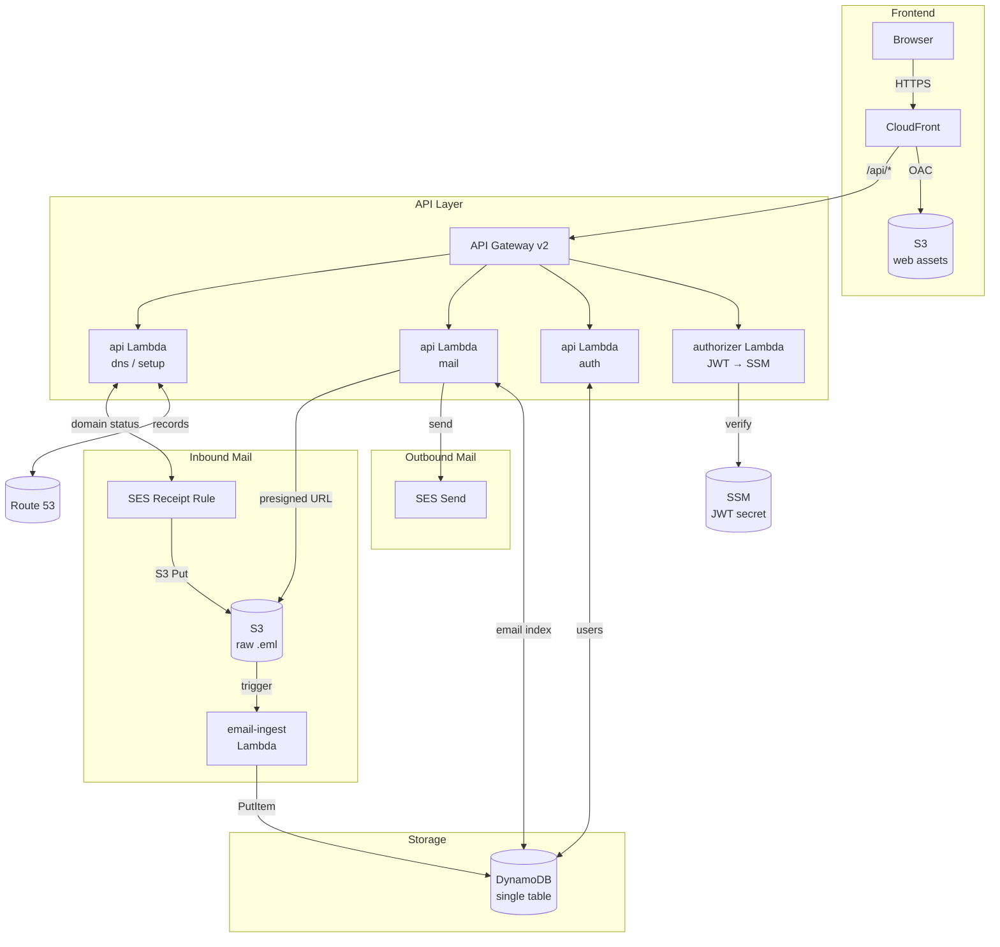

# Dork Mail

A self-hosted email server for people who thought "how hard could it really be."

Built on AWS SES, DynamoDB, and Lambda — fully serverless, no VMs, no mail transfer agents, no 3AM postfix debugging.

You know how AWS sometimes offers a really useful managed service — custom domains, multiple mailboxes, just works — and then one day quietly announces it's being deprecated? And you're left wondering what you're supposed to do now, run your own mail server? Well. Yes. This costs pennies a month and you own every bit of it.

> **Why "Dork Mail"?** Because only a dork responds to a deprecation notice by building their own mail server. We are those dorks.

---

## What it does

- **Receives email** via SES receipt rules → stores raw `.eml` in S3 → parses and indexes into DynamoDB
- **Sends email** via SES with full DKIM signing
- **Web UI** — dark mode, Gmail-ish layout: inbox, compose, reply, attachments, labels, trash
- **Setup wizard** — reads your Route 53 zone, identifies missing/incorrect DNS records (MX, SPF, DKIM, DMARC), and writes fixes with one click; manages SES verified emails for sandbox testing; submits production access requests
- **Multi-user** — multiple mailboxes on a single domain, admin-controlled user management panel
- **Account settings** — users can update their display name and change their own password
- **JWT auth** — simple, stateless, no Cognito

---

## Architecture



All AWS SDK calls use **IAM execution roles** — no access keys in any application code.

### AWS services used

| Service | Purpose |
|---|---|
| SES | Receive and send email |
| S3 | Raw `.eml` storage, web static assets |
| DynamoDB | Email index, user accounts |
| Lambda | Email ingestion, API handlers, JWT authorizer |
| API Gateway v2 | HTTP API for the web app |
| CloudFront | CDN for the web app, `/api` proxy |
| Route 53 | DNS management (zone must exist) |
| ACM | TLS certificate for the web subdomain |
| SSM Parameter Store | JWT secret (SecureString) |
| X-Ray | Distributed tracing via Powertools |

---

## Repository layout

```
dork-mail/
├── terraform/          # All AWS infrastructure — usable as a module
├── functions/          # Lambda functions (TypeScript + AWS Powertools)
│   └── src/
│       ├── email-ingest/   # S3 trigger: raw email → DynamoDB
│       ├── authorizer/     # JWT Lambda authorizer for API Gateway
│       └── api/
│           ├── auth.ts     # Login, user CRUD (admin + self-service)
│           ├── mail.ts     # List, read, send, update, delete, attachments
│           └── dns.ts      # DNS check/apply, SES status, sandbox management
├── web/                # SvelteKit frontend (dark mode)
│   └── src/routes/
│       ├── login/
│       ├── mail/           # Inbox, message view
│       │   ├── [messageId]/    # Single message view
│       │   ├── compose/        # Compose / reply
│       │   ├── account/        # Account settings (display name, password)
│       │   └── admin/users/    # Admin user management panel
│       └── setup/          # DNS wizard
├── shared/             # Shared TypeScript types
└── scripts/
    ├── publish-lambdas.sh  # Build + deploy Lambda code via update-function-code
    └── gen-password-hash.mjs  # Generate bcrypt hash for admin password
```

---

## Prerequisites

- An AWS account
- A domain with a Route 53 hosted zone already set up (the zone just needs to exist — Terraform handles the email DNS records)
- AWS CLI configured with credentials **for the human running Terraform** (this is the only place credentials are needed)
- Node.js 20+
- Terraform 1.7+

SES email receiving is only available in `us-east-1`, `us-west-2`, and `eu-west-1`. Pick one.

---

## Deployment

### 1. Install dependencies

```sh
pnpm install
```

### 2. Configure Terraform

```sh
cp terraform/terraform.tfvars.example terraform/terraform.tfvars
```

Edit `terraform.tfvars`:

```hcl
domain = "yourdomain.com"    # must have a Route 53 hosted zone in this account

# Generate: openssl rand -base64 48
jwt_secret = "..."

admin_email        = "you@yourdomain.com"
admin_display_name = "Your Name"

# Generate the bcrypt hash:
#   pnpm gen-password-hash
admin_password_hash = "$2a$12$..."
```

### 3. Apply infrastructure

```sh
cd terraform
terraform init
terraform apply
```

This will:
- Create all AWS resources
- Write MX, SPF, DKIM (3 CNAME records), and DMARC to your Route 53 zone
- Provision the CloudFront distribution at `mail.yourdomain.com`
- Wait for SES domain verification (this can take a few minutes)


### 4. Deploy Lambda functions

```sh
scripts/publish-lambdas.sh
```

This builds all handlers and pushes them directly to each Lambda function via `update-function-code`. Terraform created the functions with a stub handler — this replaces it with the real code.

Requires `jq` for the output formatting (`brew install jq` / `apt install jq`).

### 5. Deploy the web app

```sh
pnpm build:web
aws s3 sync web/build s3://$(terraform -chdir=terraform output -raw web_bucket) --delete
aws cloudfront create-invalidation \
  --distribution-id $(terraform -chdir=terraform output -raw cloudfront_distribution_id) \
  --paths "/*"
```

### 6. Done

Open `https://mail.yourdomain.com`, log in with the admin credentials you set, and you'll land on the DNS wizard. If Terraform already applied your DNS records they should show green — if anything is yellow or red, click **Apply all fixes**.

---

## Exiting the SES sandbox

New AWS accounts are in SES sandbox mode — you can only send mail to email addresses you've manually verified. To send to anyone:

1. In the setup wizard, use **Verified Emails** to add test addresses while in sandbox mode
2. When ready, click **Request production access** in the wizard (or go to AWS Console → **SES → Account Dashboard** → **Request production access**)
3. Select **Transactional** mail type
4. Describe your use case (self-hosted mail server for your own domain)
5. AWS typically approves within 24–48 hours

The setup wizard walks through all of this with live status indicators.

---

## Using as a Terraform module

The `terraform/` directory is a standalone module. You can source it from another repo without cloning this one — just make sure the Lambda zips are already in S3 first.

```hcl
module "dork_mail" {
  source = "github.com/you/dork-mail//terraform?ref=v1.0.0"

  domain              = "yourdomain.com"
  jwt_secret          = var.jwt_secret
  admin_email         = "you@yourdomain.com"
  admin_password_hash = var.admin_password_hash
}

output "mail_url" {
  value = module.dork_mail.web_url
}
```

After `terraform apply`, deploy the real Lambda code from a clone of this repo:

```sh
git clone https://github.com/you/dork-mail
cd dork-mail
pnpm install
scripts/publish-lambdas.sh
```

### Module inputs

| Variable | Required | Default | Description |
|---|---|---|---|
| `domain` | yes | — | Mail domain, e.g. `example.com` |
| `jwt_secret` | yes | — | JWT signing secret (goes to SSM SecureString) |
| `admin_email` | yes | — | Initial admin user email |
| `admin_password_hash` | yes | — | bcrypt hash of admin password |
| `admin_display_name` | no | `Admin` | Display name for admin user |
| `web_subdomain` | no | `mail` | Subdomain prefix for the UI |
| `aws_region` | no | `us-east-1` | Deployment region |
| `ses_rule_set_name` | no | `dork-mail` | SES receipt rule set name |
| `tags` | no | `{}` | Tags applied to all resources |

### Module outputs

| Output | Description |
|---|---|
| `web_url` | URL of the web UI |
| `api_endpoint` | Raw API Gateway endpoint |
| `dynamo_table` | DynamoDB table name |
| `email_bucket` | S3 bucket for raw emails |
| `cloudfront_distribution_id` | For cache invalidations on deploy |

---

## Ongoing operations

### Adding or managing users

Log in as admin and go to **Admin → Users** in the sidebar. From there you can create users, change their admin status, or delete them. Or via API:

```sh
curl -X POST https://mail.yourdomain.com/api/auth/users \
  -H "Authorization: Bearer <admin-token>" \
  -H "Content-Type: application/json" \
  -d '{"email":"newuser@yourdomain.com","password":"...","displayName":"New User"}'
```

Passwords must be at least 12 characters and include an uppercase letter, a digit, and a special character.

### Account settings

Any user can update their display name and change their own password from the **Account** page in the sidebar.

### Updating Lambda functions

```sh
scripts/publish-lambdas.sh
```

No `terraform apply` needed for code-only changes — Terraform ignores function code after initial creation.

### Updating the web app

```sh
pnpm build:web
aws s3 sync web/build s3://your-web-bucket --delete
aws cloudfront create-invalidation --distribution-id YOUR_DIST_ID --paths "/*"
```

---

## Cost

Rough estimate for light personal use (~1,000 emails/month, one user):

| Service | ~Monthly cost |
|---|---|
| SES receiving | $0.10 per 1,000 emails = **$0.10** |
| SES sending | $0.10 per 1,000 emails = **$0.10** |
| S3 (raw emails + web) | < **$0.10** |
| DynamoDB (PAY_PER_REQUEST) | < **$0.10** |
| Lambda invocations | < **$0.01** |
| API Gateway | < **$0.01** |
| CloudFront | < **$0.10** |
| **Total** | **~$0.50/month** |

The ACM certificate and Route 53 record changes are free. You'll pay for the hosted zone itself (~$0.50/month) if you don't already have one.

---

## Local development

```sh
# Start the web dev server (proxies /api to localhost:3001)
pnpm dev

# The functions don't have a local runtime yet — point VITE_API_URL at a
# deployed API Gateway endpoint for now, or use SAM/LocalStack if you want
# to run Lambda locally.
export VITE_API_URL=https://your-api-gateway-id.execute-api.us-east-1.amazonaws.com
pnpm dev
```

---

## Security notes

- **No access keys in app code** — all AWS SDK calls use Lambda execution roles
- **JWT secret** stored in SSM Parameter Store as a SecureString, never in environment variables as plaintext
- **S3 buckets** are fully private — web assets served only via CloudFront OAC, emails accessible only to Lambda roles
- **Email HTML** is rendered in a sandboxed `<iframe>` with `sandbox="allow-same-origin"` to prevent script execution
- **Attachment downloads** use short-lived (5 minute) S3 presigned URLs — no attachment bytes flow through Lambda
- **User enumeration** is prevented — login returns the same error for unknown user and wrong password
- **Password strength** enforced server-side: minimum 12 characters, must include uppercase, digit, and special character
- SES **TLS required** for all outbound sending (configured in the SES configuration set)

---

## License

Do whatever you want with it. If you make it better, consider sharing.
