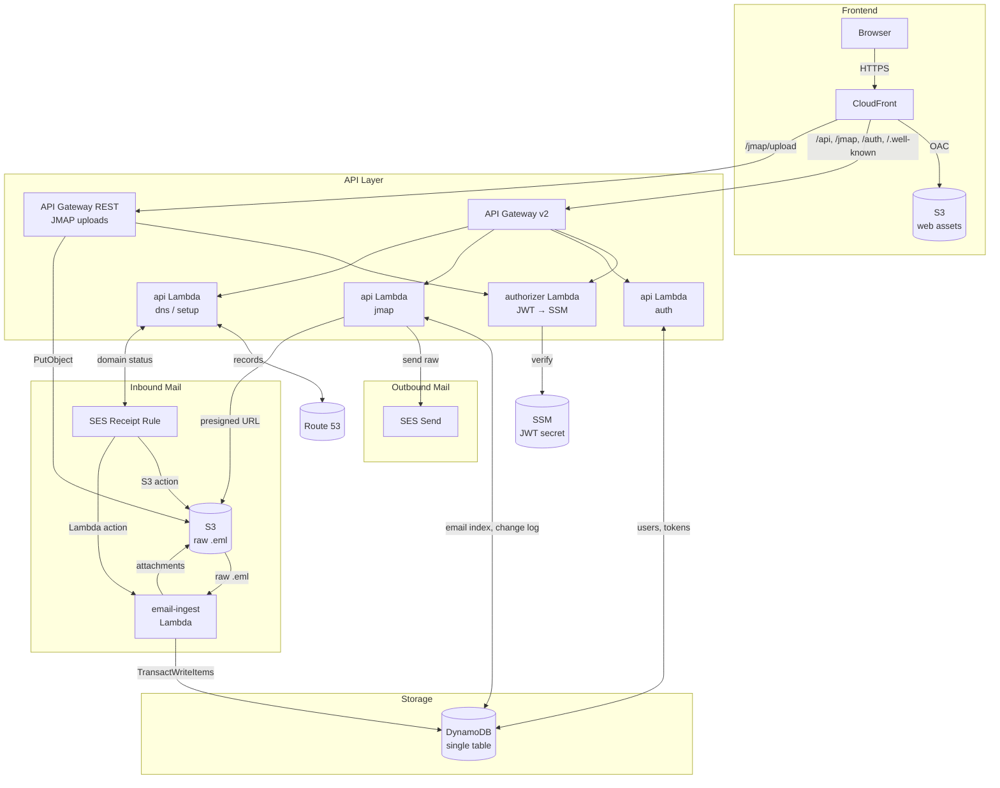

# Dork Mail

A self-hosted email server for people who thought "how hard could it really be."

Built on AWS SES, DynamoDB, and Lambda — fully serverless, no VMs, no mail transfer agents, no 3AM postfix debugging.

**Why Dork Mail?** Because only a dork responds to a deprecation notice ([cough cough](https://docs.aws.amazon.com/workmail/latest/adminguide/workmail-end-of-support.html)) by building their own mail server. We are those dorks.

---

## What it does

- **Receives email** via SES receipt rules → stores raw `.eml` in S3 → parses and indexes into DynamoDB. Mail is routed by envelope recipient, so Bcc and mailing list mail lands too, and `you+anything@domain` delivers to `you@domain`. SES spam and virus verdicts route to Spam.
- **Sends email** via SES with full DKIM signing, attachments, and proper reply threading headers
- **JMAP server** ([RFC 8620](https://www.rfc-editor.org/rfc/rfc8620), [RFC 8621](https://www.rfc-editor.org/rfc/rfc8621)) on Lambda, with mail, threads, search, drafts, and submission. Any JMAP client can connect.
- **Web UI** is an unmodified [Bulwark Lite](https://github.com/bulwarkmail/webmail) release served from the web bucket, pinned in [`scripts/bulwark-lite.json`](scripts/bulwark-lite.json). Bulwark polls for new mail every 3 seconds while it's open, hidden tabs included, since this server has no push channel.
- **Setup wizard** — reads your Route 53 zone, identifies missing/incorrect DNS records (MX, SPF, DKIM, DMARC), and writes fixes with one click; manages SES verified emails for sandbox testing; submits production access requests
- **Multi-user** — multiple mailboxes on a single domain, admin-controlled user management panel
- **Admin app** at `/admin` for the setup wizard, user management, and password changes. It has no login of its own: signing in to Bulwark sets an HttpOnly session cookie that the admin app trades for its API token, and visiting it signed out sends you to Bulwark's login. Bulwark links to it from **Settings → Account**.
- **JWT auth** — simple, stateless, no Cognito

---

## Architecture



All AWS SDK calls use **IAM execution roles** — no access keys in any application code.

### AWS services used

| Service | Purpose |
|---|---|
| SES | Receive and send email |
| S3 | Raw `.eml` storage, web static assets |
| DynamoDB | Email index, user accounts |
| Lambda | Email ingestion, API handlers, JWT authorizer |
| API Gateway v2 | HTTP API for JMAP, auth, and the admin app |
| API Gateway REST | JMAP uploads straight into S3, up to API Gateway's 10 MB request limit |
| CloudFront | CDN for Bulwark and the admin app, proxy for the APIs |
| Route 53 | DNS management (zone must exist) |
| ACM | TLS certificate for the web subdomain |
| SSM Parameter Store | JWT secret (SecureString) |

---

## Repository layout

```
dork-mail/
├── terraform/              # All AWS infrastructure — intended for use as a module
├── functions/              # Lambda functions (TypeScript + AWS Powertools)
│   ├── scripts/backfill.ts # Adds index attributes and mailbox counts to existing data (pnpm backfill)
│   └── src/
│       ├── email-ingest/   # SES receipt rule action: raw email → S3 parts + DynamoDB
│       ├── authorizer/     # JWT Lambda authorizer for API Gateway
│       ├── jmap/           # JMAP methods: Mailbox, Email, Thread, EmailSubmission, Identity
│       ├── lib/            # Shared HTTP, mail storage, and JMAP state helpers
│       └── api/
│           ├── auth.ts     # Login, token login for Bulwark, user CRUD (admin + self-service)
│           ├── jmap.ts     # JMAP session, method calls, blob downloads
│           └── dns.ts      # DNS check/apply, SES status, sandbox management
├── web/                    # SvelteKit admin app, served under /admin
│   └── src/routes/admin/
│       ├── account/        # Account settings (password)
│       ├── users/          # Admin user management panel
│       └── setup/          # DNS wizard
├── shared/                 # Shared TypeScript types
├── scripts/
│   ├── deploy-functions.ts     # Deploy Lambda code via update-function-code
│   ├── deploy-web.ts           # Bulwark Lite + admin app to S3, CloudFront invalidation
│   ├── bulwark-lite.json       # Pinned Bulwark Lite release and its checksum
│   ├── init-deploy-config.ts   # Write deploy.json from terraform output
│   └── gen-password-hash.mjs   # Generate bcrypt hash for admin password
├── deploy.example.json     # Example deploy.json (the real one is gitignored)
└── deploy.json             # Your deploy config — gitignored, generated from terraform output
```

---

## Prerequisites

- An AWS account
- A domain with a Route 53 hosted zone already set up (Terraform handles the email DNS records — the zone just needs to exist)
- AWS CLI configured with credentials **for the person running Terraform** (this is the only place credentials are needed)
- Node.js 22+
- pnpm
- Terraform 1.7+

SES email receiving is only available in `us-east-1`, `us-west-2`, and `eu-west-1`. Pick one.

---

## Deployment

The `terraform/` directory is designed to be used as a **module** from your own Terraform root — not applied in-place. This keeps your secrets and state management separate from this repo.

### 1. Install dependencies

```sh
pnpm install
```

### 2. Add dork-mail to your Terraform root

In your own Terraform configuration:

```hcl
module "dork_mail" {
  source = "github.com/you/dork-mail//terraform?ref=main"

  domain              = "yourdomain.com"
  jwt_secret          = var.jwt_secret          # openssl rand -base64 48
  admin_email         = "you@yourdomain.com"
  admin_password_hash = var.admin_password_hash  # pnpm gen-password-hash
  admin_display_name  = "Your Name"
}

# Re-export the deploy config so the deploy scripts can read it
output "deploy_config" {
  value = module.dork_mail.deploy_config
}

output "web_url" {
  value = module.dork_mail.web_url
}
```

Generate the admin password hash before applying:

```sh
pnpm gen-password-hash
```

### 3. Apply infrastructure

```sh
cd your-terraform-root
terraform init
terraform apply
```

This creates all AWS resources, writes DNS records to your Route 53 zone, provisions the CloudFront distribution at `mail.yourdomain.com`, and stores the JWT secret in SSM.

### 4. Write deploy.json

```sh
cd your-terraform-root
terraform output -raw deploy_config > /path/to/dork-mail/deploy.json
```

Or from inside this repo if your Terraform root is elsewhere:

```sh
pnpm deploy:init --tf-dir /path/to/your-terraform-root
```

This is a one-time step. `deploy.json` is gitignored — see `deploy.example.json` for its shape.

### 5. Build and deploy

```sh
pnpm build
pnpm deploy:all
```

`pnpm build` compiles the Lambda functions and the admin app. `pnpm deploy:all` pushes the Lambda zips via `update-function-code`, then uploads Bulwark Lite and the admin app to S3 and invalidates CloudFront. The first web deploy downloads the pinned Bulwark release from GitHub, checks it against the pinned SHA-256, and unpacks it into `.bulwark/`, so `unzip` must be on your PATH.

### 6. Done

Sign in at `https://mail.yourdomain.com` with your admin credentials, then open `https://mail.yourdomain.com/admin` and go to **Setup / DNS**. If Terraform already wrote your DNS records they should show green. If anything is yellow or red, click **Apply all fixes**.

---

## Exiting the SES sandbox

New AWS accounts are in SES sandbox mode — you can only send mail to email addresses you've manually verified. To send to anyone:

1. In the setup wizard, use **Verified Emails** to add test addresses while in sandbox mode
2. When ready, click **Request production access** in the wizard (or go to AWS Console → **SES → Account Dashboard** → **Request production access**)
3. Select **Transactional** mail type
4. Describe your use case (self-hosted mail server for your own domain)
5. AWS typically approves within 24–48 hours

The setup wizard walks through all of this with live status indicators.

---

## Module reference

### Inputs

| Variable | Required | Default | Description |
|---|---|---|---|
| `domain` | yes | — | Mail domain, e.g. `example.com` |
| `jwt_secret` | yes | — | JWT signing secret (stored in SSM SecureString) |
| `admin_email` | yes | — | Initial admin user email |
| `admin_password_hash` | yes | — | bcrypt hash of admin password |
| `admin_display_name` | no | `Admin` | Display name for admin user |
| `web_subdomain` | no | `mail` | Subdomain prefix for the UI |
| `aws_region` | no | `us-east-1` | Deployment region |
| `ses_rule_set_name` | no | `dork-mail` | SES receipt rule set name |
| `alert_email` | no | `""` | Address subscribed to alarms, such as mail that failed to ingest. Confirm the SNS subscription email it receives. |
| `dmarc_report_email` | no | `""` | Address for DMARC aggregate reports. Empty publishes DMARC without reports. |
| `tags` | no | `{}` | Tags applied to all resources |

### Outputs

| Output | Description |
|---|---|
| `deploy_config` | JSON blob consumed by the deploy scripts. Pipe to `deploy.json` after apply. |
| `web_url` | URL of the web UI |
| `ses_verification_status` | Helper command to check SES domain verification status |

---

## Ongoing operations

### Redeploying after code changes

```sh
pnpm build
pnpm deploy:all
```

No `terraform apply` needed for code-only changes — Terraform ignores function code after initial creation.

To redeploy just one layer:

```sh
pnpm deploy:functions   # Lambda only
pnpm deploy:web         # S3 + CloudFront only
```

### Reindexing mail

`pnpm backfill` scans the table and adds the folder-index, thread-index, and search attributes to any mail item that lacks them. It also writes attachments for items whose attachment objects are missing from S3, re-parsing the raw `.eml` while it still exists (raw mail expires after 90 days). It reads `table` and `email_bucket` from `deploy.json` and is safe to re-run.

Folder lists read from the `folder-index` GSI, so mail without those attributes doesn't show up in any folder until this runs.

It also tags every user for the `user-index` GSI that the admin user list reads, and stores each mailbox's per-folder email and unread counts on its state item. Until a mailbox has stored counts, `Mailbox/get` counts the folder index on every call, which gets slow and costly as mail piles up. Run it once after upgrading from a version without them. Users created afterwards start with counts.

### Failed deliveries

SES hands each inbound message to the email-ingest Lambda asynchronously. When ingest still fails after Lambda's two retries, the event goes to the `dork-mail-email-ingest-failed` SQS queue and the `dork-mail-email-ingest-failed` alarm fires. The raw message stays in `incoming/` for 90 days. Fix the cause from the email-ingest logs, then invoke the function with each queued message's `requestPayload` field to deliver it, and delete the message from the queue.

### Updating Bulwark

Set the new `version` and the `sha256` of its `bulwark-lite-<version>.zip` release asset in [`scripts/bulwark-lite.json`](scripts/bulwark-lite.json), then run `pnpm deploy:web`. The deploy skips the Bulwark upload when the bucket already holds that build. Bulwark is AGPL-3.0 and is served unmodified.

### Other JMAP clients

The session resource is at `https://mail.yourdomain.com/.well-known/jmap`. Clients sign in with Stalwart-style token login (`POST /api/auth`, then `POST /auth/token`) and send the access token as a Bearer token. Mailboxes are the fixed folders, and an email is always in exactly one of them. There's no push channel, so clients poll.

### Adding or managing users

While signed in to Bulwark as an admin, open `/admin`, which lands on **Users**. Or via API, with a one hour token from `POST /api/auth/login`:

```sh
curl -X POST https://mail.yourdomain.com/api/auth/users \
  -H "Authorization: Bearer <admin-token>" \
  -H "Content-Type: application/json" \
  -d '{"email":"newuser@yourdomain.com","password":"...","displayName":"New User"}'
```

Passwords must be at least 12 characters and include an uppercase letter, a digit, and a special character. Users sign in with either the part before the `@` or their full address.

Deleting a user deletes their mailbox and the S3 objects under their account: sent mail, drafts, uploads, and sent attachments. Inbound attachments and large inbound bodies are shared by every local recipient of a message, so they stay.

### Account settings

Any user can change their own password from the **Account** page at `/admin`, which asks for the current password, admins included. Changing a password revokes all of that user's sessions, so they sign in again in Bulwark. Display names and signatures are edited in Bulwark's identity settings.

---

## Cost

Rough us-east-1 estimate for light personal use: ~1,000 emails/month, one user, Bulwark open about 8 hours a day. Most of the request cost is Bulwark's 3 second poll, about 288,000 requests a month at that usage.

| Service | ~Monthly cost |
|---|---|
| SES receiving | $0.10 per 1,000 emails = **$0.10** |
| SES sending | $0.10 per 1,000 emails = **$0.10** |
| S3 (raw emails + web) | < **$0.10** |
| DynamoDB (PAY_PER_REQUEST) | **~$0.10**, plus ~$0.45 per GB of stored mail for storage and point-in-time recovery |
| API Gateway | **~$0.30** |
| CloudWatch Logs | **~$0.10** |
| Lambda | **$0** within the always-free tier, ~$0.20 past it |
| CloudFront | **$0** within the always-free tier, ~$0.30 past it |
| CloudWatch alarm, SQS, SNS | **$0** unless ingest fails, $0.10 for the alarm past the free 10 |
| **Total** | **~$0.80/month**, ~$1.40 without free tiers |

Each extra browser tab or device with Bulwark left open around the clock adds ~$1.30/month: ~$0.86 of API Gateway, ~$0.22 of DynamoDB reads and ~$0.25 of logs. Browsers slow hidden tabs, Chrome to about once a minute after 5 minutes, so the real figure is usually lower.

The ACM certificate and Route 53 record changes are free. You'll pay for the hosted zone itself (~$0.50/month) if you don't already have one.

---

## Local development

```sh
# Start the admin app dev server at /admin (proxies /api to localhost:3001)
pnpm dev

# The functions don't have a local runtime yet — point VITE_API_URL at a
# deployed API Gateway endpoint for now, or use SAM/LocalStack if you want
# to run Lambda locally.
export VITE_API_URL=https://your-api-gateway-id.execute-api.us-east-1.amazonaws.com
pnpm dev
```

---

## Security notes

- **No access keys in app code** — all AWS SDK calls use Lambda execution roles
- **JWT secret** stored in SSM Parameter Store as a SecureString, never in environment variables as plaintext
- **S3 buckets** are fully private — web assets served only via CloudFront OAC, emails accessible only to Lambda roles
- **Email HTML** rendering is Bulwark's. The web origin serves Bulwark's own CSP through a CloudFront response headers policy, with `connect-src` narrowed to the origin and the emails bucket, plus HSTS.
- **Inbound mail** is filed under the time SES received it, not the sender's `Date` header, so a sender can't bury a message or pin it to the top. Mail that fails DMARC from a domain whose policy is `quarantine` or `reject`, including mail forged as your own domain, goes to Spam. Virus-flagged mail goes to Spam without its attachments.
- **Stored parts** are keyed by the SES message id or the account, never by the Message-ID, which a sender chooses.
- **Attachment downloads** redirect to short-lived (5 minute) S3 presigned URLs. Uploads go straight to S3 through API Gateway under a key named after the caller's account, so attachment bytes only pass through Lambda when a message is sent.
- **Bulwark sessions** use a 1 hour access token and a 30 day refresh token, stored hashed in DynamoDB and revoked on sign out or password change. Every refresh issues a new refresh token, and the old one stops working a minute later. The refresh token of the most recent Bulwark sign-in rides in an HttpOnly, `SameSite=Strict` cookie for the admin app, so signing out of that account in Bulwark also ends the admin session. Signing out of the admin app revokes the refresh token, and Bulwark's session ends when its current access token expires, within an hour. The admin app keeps its own API token in memory only.
- **Revoked access** takes effect within the 5 minute authorizer cache: the authorizer checks that the user still exists, rejects tokens issued before their last password change, and reads admin status from the user record, not the token
- **Password guessing** locks an account for 30 seconds after 5 failures in a row, doubling with each further failure up to 15 minutes. API Gateway also throttles the two password endpoints to 5 requests per second across all callers.
- **User enumeration** is prevented — login returns the same error for unknown user and wrong password
- **Password strength** enforced server-side: minimum 12 characters, must include uppercase, digit, and special character
- SES **TLS required** for all outbound sending (configured in the SES configuration set)

---

## License

Do whatever you want with it. If you make it better, consider sharing.
